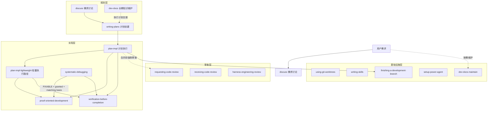

# 系统架构

Power-Agent 是一个 AI 编码 Agent 工作流插件系统，融合了 superpowers 和 Harness Engineering 两套方法论。

## 顶层架构



`systematic-debugging` 的 `missing | unknown | basis mismatch` 只保留 `FIXABLE` handoff 并请求最小授权，不进入 POD。

## 模块划分

| 层级 | Skill | 职责 |
|------|-------|------|
| **规划层** | `discuss` | 需求讨论与 PRD 细化，必要时用 HTML 可视化辅助，默认产出内联需求结论，按需落盘 spec/doc |
| | `writing-plans` | 需求结论 / spec / 用户描述 → compact exec-plan；所有计划 self-review，中/高风险增加独立 reviewer，`review-contract.md` 供人类按需审阅 |
| | `dev-docs` | 维护 `docs/` 中可长期复用的工程知识：稳定系统事实、边界、决策依据与集成参考；实施、重构、迁移和任务拆解计划交给 `writing-plans` |
| **实现层** | `plan-impl` | 状态机编排，驱动全生命周期；READY 校验计划材料的风险与独立审查记录，实质 amendment 递增 revision 并重新进入风险审查；优先使用 team 模式，缺失 team 工具时回退并行或单实现子代理；以 scratch artifacts 交接并执行单 reviewer 双 verdict 内审 |
| | `plan-impl-lightweight` | 中等偏小任务的轻量执行路径：scope_check、proof-oriented 实现、局部验证、有限 review/fix 循环、必要时升级完整 runner |
| | `proof-oriented-development` | 证明导向开发闭环：小步实现、最小相关验证、输出 Proof Block |
| | `systematic-debugging` | 探索式根因调查：可区分 feedback loop、因果证据、original/minimal repro、安全边界，以及与执行授权解耦的修复交接 |
| | `verification-before-completion` | 审计 Proof Block / 等价证据块、原始复现、临时产物和风险相称的性能/稳定性证据，输出 verification_evidence |
| **审查层** | `requesting-code-review` | 风险分级全量审查编排 |
| | `receiving-code-review` | 审查反馈技术评估 |
| | `harness-engineering-review` | Agent 工作流七维度审查 |
| **基础设施层** | `using-git-worktrees` | 隔离工作区检测、创建与基线准备 |
| | `writing-skills` | Skill 创建、修改、契约审查与压力场景验证 |
| | `finishing-a-development-branch` | 分支处置决策器（merge/PR/保留/丢弃） |
| | `setup-power-agent` | 项目知识体系初始化 |
| | `dev-docs-maintain` | 按需检查既有 `docs/` OKF Bundle 健康状态，修复结构或知识漂移，并登记已完成验证到 verification ledger |

## 依赖方向

```
用户需求
    │
    ▼
discuss / 直接描述
    │
    ▼
writing-plans（规划）
    │
    ▼
docs/exec-plans/active/
    │
    ▼
plan-impl（实现编排）
    │
    ├── using-git-worktrees（隔离工作区）
    ├── plan-impl-lightweight（中小任务轻量执行路径）
    ├── proof-oriented-development（证明导向实现子代理）
    ├── scratch review artifacts（task brief / report / review package）
    ├── 单内部 reviewer（规格符合性 + 代码质量双 verdict）
    ├── requesting-code-review（最终验证前全量审查）
    ├── verification-before-completion（Proof Block 审计与 verification_evidence）
    └── finishing-a-development-branch（分支收尾）

requesting-code-review 在最终验证前默认强制执行；合并/PR 前不得跳过未通过的审查结果，除非用户明确要求跳过。`dev-docs-maintain` 是按需触发的既有 `docs/` Bundle 健康检查、漂移修复和 verification ledger 登记入口，不属于 plan-impl 的固定主流程。
```

**硬规则：** 依赖只能从上层指向下层，禁止反向依赖。

## 产出物流转

| 产出物 | 生产者 | 消费者 | 位置 |
|--------|--------|--------|------|
| 需求结论 / Spec 文档 | `discuss` | `writing-plans` | 默认内联传递；按需 `docs/specs/YYYY-MM-DD-*.md` |
| Compact exec-plan（`plan.md + review-contract.md`，按需 `context.md/tasks.md`） | `writing-plans` | 人类默认审 `review-contract.md`；`plan-impl` 必读两份材料并在 READY 校验 Gate，按需读取拆分材料 | `docs/exec-plans/active/` |
| Scratch review artifacts | `plan-impl` / 实现子代理 | 单内部 reviewer | `.power-agent/review-runs/<run-id>/`（自忽略、可重建） |
| 代码变更 | `plan-impl` 子代理 | 单内部 reviewer / `requesting-code-review`（最终验证前） | Git working-tree diff |
| Session Log | `plan-impl` | 归档 | `docs/exec-plans/completed/` |
| 分支处置结论 | `finishing-a-development-branch` | plan-impl / 用户 | 结构化输出 |
| Skill 压力场景 | `writing-skills` | Skill 作者 / reviewer | Skill 修改说明或 docs |

## 子代理模式

**核心原则：** 子代理是一次性的，主代理不与同一子代理进行多轮对话。

| 子代理类型 | 用途 | 调用者 |
|----------|------|--------|
| `explore` | 代码探索，返回关键文件列表 | discuss, dev-docs |
| `tech-plan-reviewer` | 需求结论审查；中/高风险计划审查 | discuss, writing-plans |
| 实现子代理 | POD 增量实现 | plan-impl |
| 审查子代理 | 代码审查（风险分级 1-2 个并行） | plan-impl, requesting-code-review |
| 验证子代理 | 最终验证 | plan-impl |

**并发限制：** 最大并行度 3，超过则分批。

## Gate 机制

| Gate 位置 | 触发条件 | 动作 |
|-----------|---------|------|
| discuss 最终审查 | 需求结论完成 + 独立 reviewer 审查通过 | 交给 `writing-plans` |
| writing-plans 风险审查 | low=self-review；medium/high=独立 reviewer 通过 | 交给 `plan-impl` |
| plan-impl READY | 准备首次执行或恢复执行 | 校验两份计划材料同名的 Gate Revision、风险状态和 revision-bound basis；medium/high pending、缺失、冲突或 basis 不匹配时停止在 READY |
| plan-impl 执行中 | 3 轮修复失败，或计划前提假设失效 | Escalate 给用户 |
| finishing-a-development-branch | 丢弃路径（高风险操作） | 要求明确确认 |

## 设计原则

详见 [ADR 目录](adr/)。核心原则概要：

1. **Skill 是执行单元，人类是决策者**（ADR-0001）
2. **产出物是协调介质** — 跨阶段状态通过文件传递，编排调用必须保留明确契约（ADR-0003）
3. **仓库是唯一真相来源** — Agent 看不到的内容不存在
4. **AGENTS.md 是目录，不是百科全书**（ADR-0004）
5. **机械化约束优于 Prompt 啰嗦** — 证据/测试 > 文字规则
6. **证据优先** — 没有新鲜验证不得声称完成
7. **上下文按需交接** — 大段任务、报告和 diff 通过 scratch artifacts 传递；对话只携带路径、状态和短摘要
