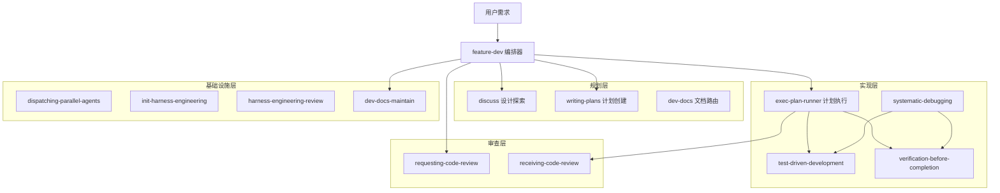

<!-- verified: 2026-03-25 -->
<!-- scope: architecture -->

# 系统架构

Power-Agent 是一个 AI 编码 Agent 工作流插件系统，融合了 superpowers 和 Harness Engineering 两套方法论。

## 顶层架构




## 模块划分


| 层级        | Skill                            | 职责                      |
| --------- | -------------------------------- | ----------------------- |
| **编排层**   | `feature-dev`                    | 引导式开发，串联所有其他 Skill   |
| **规划层**   | `discuss`                        | 设计探索，产出 spec 文档         |
|           | `writing-plans`                  | Spec → TDD 结构 exec-plan |
|           | `dev-docs`                       | 文档路由器，委派或创建文档           |
| **实现层**   | `exec-plan-runner`               | 子代理并行执行 exec-plan       |
|           | `test-driven-development`        | RED-GREEN-REFACTOR 强制执行 |
|           | `systematic-debugging`           | 四阶段根因优先调试               |
|           | `verification-before-completion` | 证据优先验证                  |
| **审查层**   | `requesting-code-review`         | 代码审查编排                  |
|           | `receiving-code-review`          | 审查反馈技术评估                |
| **基础设施层** | `dispatching-parallel-agents`    | 通用并行调度                  |
|           | `init-harness-engineering`       | 项目知识体系初始化               |
|           | `harness-engineering-review`     | Harness 实践审查            |
|           | `dev-docs-maintain`              | 文档维护（Doc Gardening）     |


## 依赖方向

```
用户需求
    │
    ▼
feature-dev (编排器)
    │
    ├── discuss / writing-plans (规划)
    │       │
    │       ▼
    │   docs/specs/*.md
    │       │
    │       ▼
    │   docs/exec-plans/active/
    │
    ├── exec-plan-runner (实现)
    │       │
    │       ├── TDD 子代理
    │       ├── 审查子代理
    │       └── 验证子代理
    │
    ├── requesting-code-review (审查)
    │
    └── dev-docs-maintain (维护)
```

**硬规则：** 依赖只能从上层指向下层，禁止反向依赖。

## 产出物流转


| 产出物       | 生产者                    | 消费者                            | 位置                           |
| --------- | ---------------------- | ------------------------------ | ---------------------------- |
| Spec 文档   | `discuss`              | `writing-plans`, `feature-dev` | `docs/specs/*.md`            |
| Exec-plan | `writing-plans`        | `exec-plan-runner`             | `docs/exec-plans/active/`    |
| 代码变更      | `exec-plan-runner` 子代理 | `requesting-code-review`       | Git diff                     |
| 归档计划      | `dev-docs-maintain`    | -                              | `docs/exec-plans/completed/` |


## 子代理模式

**核心原则：** 子代理是一次性的，主代理不与同一子代理进行多轮对话。


| 子代理类型                | 用途            | 调用者                                      |
| -------------------- | ------------- | ---------------------------------------- |
| `explore`            | 代码探索，返回关键文件列表 | feature-dev, discuss, dev-docs           |
| `code-architect`     | 架构设计，产出方案对比   | feature-dev 阶段 4                         |
| `tech-plan-reviewer` | 计划/spec 审查    | discuss, writing-plans                   |
| 实现子代理                | TDD 实现        | exec-plan-runner                         |
| 审查子代理                | 代码审查          | exec-plan-runner, requesting-code-review |
| 验证子代理                | 最终验证          | exec-plan-runner                         |


**并发限制：** 最大并行度 3，超过则分批。

## Gate 机制


| Gate 位置            | 触发条件            | 动作           |
| ------------------ | --------------- | ------------ |
| discuss Step 7     | spec 完成后        | 等待用户批准       |
| feature-dev 阶段 3 后 | 澄清完成            | 等待用户确认       |
| feature-dev 阶段 4 后 | 架构方案呈现          | 等待用户选择       |
| feature-dev 阶段 6 前 | 准备实现            | 等待用户明确批准     |
| exec-plan-runner   | 歧义/破坏性变更/3轮修复失败 | Escalate 给用户 |


## 设计原则

详见 [设计决策索引](arch-decisions/index.md) 和 [Harness Engineering 体系](harness-engineering.md)。核心原则概要：

1. **Skill 是执行单元，人类是决策者**（[DD-001](arch-decisions/DD-001-skill-as-execution-unit.md)）
2. **产出物是协调介质**（[DD-003](arch-decisions/DD-003-artifacts-as-coordination.md)）
3. **仓库是唯一真相来源** — Agent 看不到的内容不存在
4. **AGENTS.md 是目录，不是百科全书**（[DD-004](arch-decisions/DD-004-lean-agents-md.md)）
5. **机械化约束优于 Prompt 啰嗦** — Linter/Test > 文字规则
6. **证据优先** — 没有新鲜验证不得声称完成

