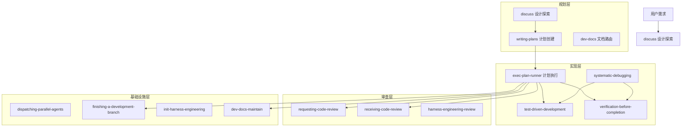

<!-- verified: 2026-04-21 -->
<!-- scope: architecture -->

# 系统架构

Power-Agent 是一个 AI 编码 Agent 工作流插件系统，融合了 superpowers 和 Harness Engineering 两套方法论。

## 顶层架构



## 模块划分

| 层级 | Skill | 职责 |
|------|-------|------|
| **规划层** | `discuss` | 需求探索，产出 spec 文档 |
| | `writing-plans` | Spec → 三文档 exec-plan |
| | `dev-docs` | 文档路由器，委派或创建文档 |
| **实现层** | `exec-plan-runner` | 状态机编排，驱动全生命周期 |
| | `test-driven-development` | 增量测试循环，RED-GREEN-REFACTOR |
| | `systematic-debugging` | 四阶段根因优先调试 |
| | `verification-before-completion` | 证据优先验证，拦截无证据声明 |
| **审查层** | `requesting-code-review` | 风险分级全量审查编排 |
| | `receiving-code-review` | 审查反馈技术评估 |
| | `harness-engineering-review` | Agent 工作流七维度审查 |
| **基础设施层** | `dispatching-parallel-agents` | 通用并行调度（最大并行度 3） |
| | `finishing-a-development-branch` | 分支处置决策器（merge/PR/保留/丢弃） |
| | `init-harness-engineering` | 项目知识体系初始化 |
| | `dev-docs-maintain` | 文档维护（Doc Gardening） |

## 依赖方向

```
用户需求
    │
    ▼
discuss / 直接描述
    │
    ▼
writing-plans（规划）
    │
    ▼
docs/exec-plans/active/
    │
    ▼
exec-plan-runner（实现编排）
    │
    ├── test-driven-development（实现子代理）
    ├── receiving-code-review（反馈评估）
    ├── verification-before-completion（全量验证）
    ├── requesting-code-review（可选全量审查）
    └── finishing-a-development-branch（分支收尾）
    │
    ▼
dev-docs-maintain（文档同步）
```

**硬规则：** 依赖只能从上层指向下层，禁止反向依赖。

## 产出物流转

| 产出物 | 生产者 | 消费者 | 位置 |
|--------|--------|--------|------|
| Spec 文档 | `discuss` | `writing-plans` | `docs/specs/YYYY-MM-DD-*.md` |
| Exec-plan | `writing-plans` | `exec-plan-runner` | `docs/exec-plans/active/` |
| 代码变更 | `exec-plan-runner` 子代理 | `requesting-code-review` | Git diff |
| Session Log | `exec-plan-runner` | 归档 | `docs/exec-plans/completed/` |
| 分支处置结论 | `finishing-a-development-branch` | exec-plan-runner / 用户 | 结构化输出 |

## 子代理模式

**核心原则：** 子代理是一次性的，主代理不与同一子代理进行多轮对话。

| 子代理类型 | 用途 | 调用者 |
|----------|------|--------|
| `explore` | 代码探索，返回关键文件列表 | discuss, dev-docs |
| `tech-plan-reviewer` | 计划/spec 审查 | discuss, writing-plans |
| 实现子代理 | TDD 增量实现 | exec-plan-runner |
| 审查子代理 | 代码审查（风险分级 1-2 个并行） | exec-plan-runner, requesting-code-review |
| 验证子代理 | 最终验证 | exec-plan-runner |

**并发限制：** 最大并行度 3，超过则分批。

## Gate 机制

| Gate 位置 | 触发条件 | 动作 |
|-----------|---------|------|
| discuss Step 最终 | spec 草稿完成 + spec-reviewer 审查通过 | 等待用户批准（强制 Gate） |
| exec-plan-runner 启动前 | 准备实现 | 轻量启动通知（非强制 Gate，worktree 沙盒隔离兜底）（DD-006） |
| exec-plan-runner 执行中 | 3 轮修复失败，或计划前提假设失效 | Escalate 给用户 |
| finishing-a-development-branch | 丢弃路径（高风险操作） | 要求明确确认 |

## 设计原则

详见 [设计决策索引](arch-decisions/index.md)。核心原则概要：

1. **Skill 是执行单元，人类是决策者**（DD-001）
2. **产出物是协调介质** — Skill 之间通过文件\"传话\"（DD-003）
3. **仓库是唯一真相来源** — Agent 看不到的内容不存在
4. **AGENTS.md 是目录，不是百科全书**（DD-004）
5. **机械化约束优于 Prompt 啰嗦** — 证据/测试 > 文字规则
6. **证据优先** — 没有新鲜验证不得声称完成
