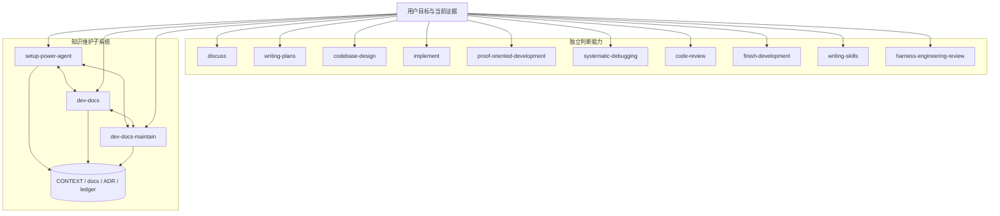

# 系统架构

Power-Agent 是一组按需加载的判断单元。每个 Skill 帮助模型处理一种承重判断，并对自己的用户目标负责；系统不预先规定 Skill 顺序，也不把多阶段流程当作默认正确性来源。当前设计由 [ADR-0010](adr/0010-judgment-oriented-skills.md) 定义。

## 顶层结构

图中的并列边表示“按当前目标选择”，不是建议全部调用。普通 Skill 之间没有运行时依赖；同一任务中是否组合，由模型根据缺失判断、已有材料和验收需要决定。

## 能力边界

| Skill | 独立负责的结果 |
|---|---|
| `discuss` | 形成足以支持当前决策或行动的清晰结论 |
| `writing-plans` | 让后续执行者能从持久计划理解目标、边界、关键决策和验收 |
| `codebase-design` | 判断模块边界、接口、seam 和 adapter 是否真正减少复杂度 |
| `implement` | 从用户目标或任意已有计划组织 sub-agent，完成变更并取得证据 |
| `proof-oriented-development` | 用最小充分改动实现一个明确目标，并证明可观察结果 |
| `systematic-debugging` | 用区分性证据找出最可信根因；授权覆盖时可直接修复和验证 |
| `code-review` | 找出会妨碍安全、正确交付的问题，并给出可定位证据 |
| `finish-development` | 判断工作是否足以完成；按用户授权处理提交、PR、合并、保留或丢弃 |
| `writing-skills` | 创建或改进能迁移判断、且结果可验证的 Skill |
| `harness-engineering-review` | 判断 Harness 中哪些机制承重、哪些只是流程成本 |
| `setup-power-agent` | 建立项目实际需要的最小知识体系与导航 |
| `dev-docs` | 把稳定、可复用的系统知识写入 Knowledge Bundle |
| `dev-docs-maintain` | 扫描 Bundle、修复结构或漂移并原子登记验证 |

## 独立性规则

普通 Skill 可以：

- 使用用户给出的文字、计划、diff、日志、运行结果或其他已有材料；
- 直接读取仓库与外部权威源；
- 使用普通 sub-agent 探索、实现、审查或验证；
- 输出对当前用户最有用的结论和证据。

普通 Skill 不应：

- 要求输入由另一个具名 Skill 产生；
- 用固定状态、交接 schema 或文件布局证明流程已执行；
- 仅输出“下一步调用哪个 Skill”而不完成自己的目标；
- 因为任务复杂就自动增加固定审查层、轮数或持久产物。

知识维护三个 Skill 是例外，因为它们共同拥有同一个 Bundle 的初始化、语义和机械完整性。它们可按缺口互相使用，但调用关系不是固定链：纯语义写入可能只需要 `dev-docs`，纯扫描或 ledger 操作可能只需要 `dev-docs-maintain`，初始化也只创建项目真实需要的部分。

## Sub-agent 模型

支持平台必须提供普通 sub-agent 的任务传入、上下文传递、结果收集和并行运行。Power-Agent 不建立平台专属 team/group 抽象，也不规定并发数字。

模型根据任务图决定并行：

- 没有数据依赖且写所有权不重叠的工作可以同时执行；
- 共享接口、共享文件或后续决策依赖前序证据时先明确契约或串行；
- 子代理结果是证据候选，不是自动接受的完成证明；调用者仍负责整合和验证。

## 产出物与证据

代码、测试结果、日志、截图、benchmark、计划和 review finding 都是帮助判断的材料，不是必须经过的站点。

Durable artifact 只在它解决真实问题时存在，例如跨会话恢复、人类审阅、外部协议或长期知识。短任务可以直接以 working-tree diff 和新鲜验证交付。dirty working tree 不妨碍验证；只有提交、PR 或合并等 commit-bound 行为才需要把证据与具体提交对应。

严格格式只保留在真实机器边界：

- `docs/.okf/verification.json` 等 ledger；
- scanner、hook、测试和脚本输入输出；
- 平台 API、文件格式和授权协议；
- 会造成外部副作用或数据损失的确认边界。

## 设计原则

1. **判断可迁移，结果可验证**：过程可变，目标、约束与验收必须清楚。
2. **Skill 是独立能力**：组合由现场需要产生，不由仓库预绑。
3. **证据外置**：完成声明必须匹配新鲜、可复现的系统外证据。
4. **复杂度由证据购买**：保留 ADR-0008 的动机，不保留 ordered ladder 运行义务。
5. **仓库保存长期真相**：临时上下文可来自 session、CI 或观测系统；稳定决策和不变量回到 repo。
6. **Prompt 留给判断**：确定性工作进入代码、测试、schema 或工具。
7. **授权不因自治而弱化**：模型自主执行可逆工作，人类持有意图、高风险取舍与不可逆动作。
8. **Harness 持续做 ablation**：模型或宿主升级后，先删除已不承重的机制。
