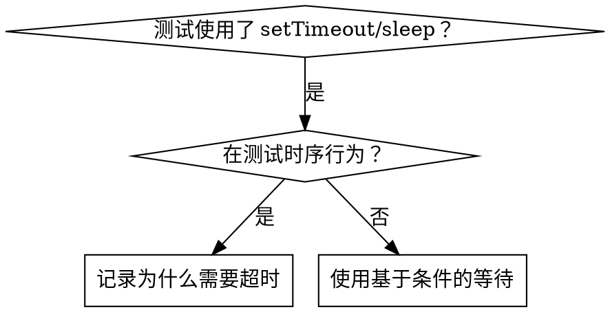

# 基于条件的等待

## 概述

不稳定测试通常用任意延迟来猜测时序。这会产生竞态条件，导致测试在快速机器上通过，但在高负载或 CI 环境下失败。

**核心原则：** 等待你真正关心的条件满足，而不是猜测需要多长时间。

## 使用时机



**适用场景：**
- 测试有任意延迟（`setTimeout`、`sleep`、`time.sleep()`）
- 测试不稳定（时而通过，高负载时失败）
- 并行运行时测试超时
- 等待异步操作完成

**不适用场景：**
- 测试实际的时序行为（防抖、节流间隔）
- 若使用任意超时，必须注释说明原因

## 核心模式

```typescript
// ❌ 之前：猜测时序
await new Promise(r => setTimeout(r, 50));
const result = getResult();
expect(result).toBeDefined();

// ✅ 之后：等待条件满足
await waitFor(() => getResult() !== undefined);
const result = getResult();
expect(result).toBeDefined();
```

## 快速模式参考

| 场景 | 模式 |
|------|------|
| 等待事件 | `waitFor(() => events.find(e => e.type === 'DONE'))` |
| 等待状态 | `waitFor(() => machine.state === 'ready')` |
| 等待数量 | `waitFor(() => items.length >= 5)` |
| 等待文件 | `waitFor(() => fs.existsSync(path))` |
| 复杂条件 | `waitFor(() => obj.ready && obj.value > 10)` |

## 实现

通用轮询函数：
```typescript
async function waitFor<T>(
  condition: () => T | undefined | null | false,
  description: string,
  timeoutMs = 5000
): Promise<T> {
  const startTime = Date.now();

  while (true) {
    const result = condition();
    if (result) return result;

    if (Date.now() - startTime > timeoutMs) {
      throw new Error(`等待 ${description} 超时（${timeoutMs}ms）`);
    }

    await new Promise(r => setTimeout(r, 10)); // 每 10ms 轮询一次
  }
}
```

完整实现（含领域专用辅助函数 `waitForEvent`、`waitForEventCount`、`waitForEventMatch`）见同目录 `condition-based-waiting-example.ts`。

## 常见错误

**❌ 轮询过快：** `setTimeout(check, 1)` — 浪费 CPU  
**✅ 修复：** 每 10ms 轮询一次

**❌ 无超时：** 条件永不满足时无限循环  
**✅ 修复：** 始终包含超时并给出清晰错误信息

**❌ 数据过期：** 在循环前缓存了状态  
**✅ 修复：** 在循环内调用 getter 以获取最新数据

## 任意超时合理的场景

```typescript
// 工具每 100ms 触发一次——需要 2 次触发才能验证部分输出
await waitForEvent(manager, 'TOOL_STARTED'); // 先等条件满足
await new Promise(r => setTimeout(r, 200));   // 再等时序行为
// 200ms = 2 次触发（100ms 间隔）——有文档依据，合理
```

**要求：**
1. 先等触发条件
2. 基于已知时序（不是猜测）
3. 注释说明原因

## 真实案例效果

来自某次调试会话（2025-10-03）：
- 修复了 3 个文件中的 15 个不稳定测试
- 通过率：60% → 100%
- 执行时间：快了 40%
- 消除了所有竞态条件
