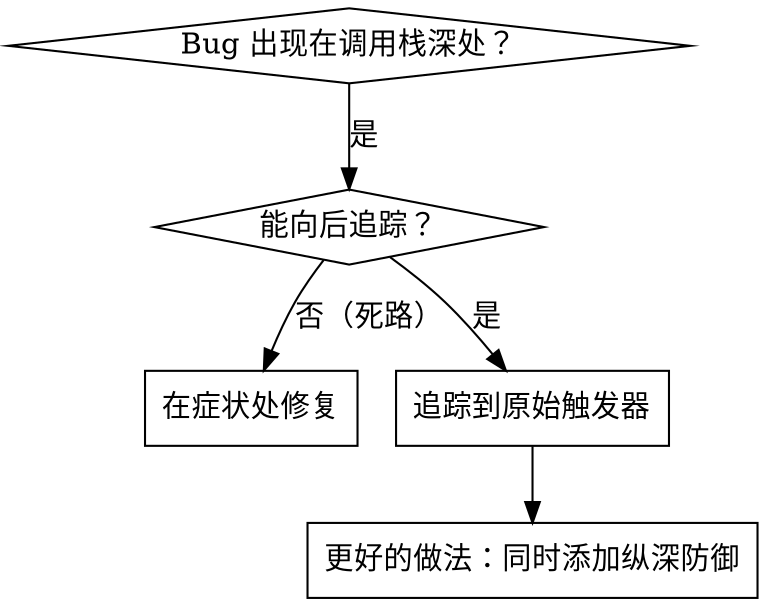
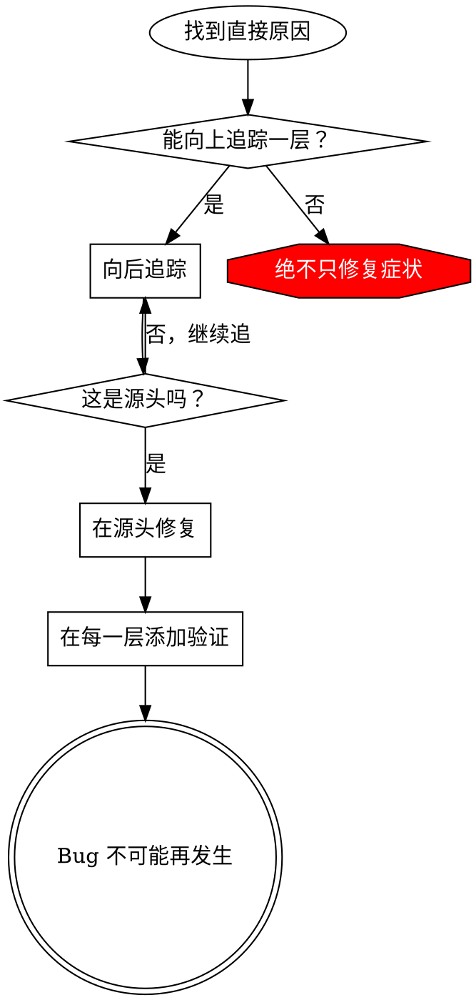

# 根本原因追踪

## 概述

Bug 通常在调用栈深处显现（如 git init 在错误目录执行、文件创建在错误位置、数据库以错误路径打开）。直觉告诉我们在错误出现处修复，但那是在治症状。

**核心原则：** 向后追踪调用链，直到找到原始触发器，然后在源头修复。

## 使用时机



**适用场景：**
- 错误发生在执行深处（不在入口点）
- 堆栈跟踪显示很长的调用链
- 不清楚无效数据从哪里来
- 需要找出哪个测试/代码触发了问题

## 追踪过程

### 1. 观察症状
```
Error: git init failed in /Users/jesse/project/packages/core
```

### 2. 找到直接原因
**哪段代码直接导致了这个问题？**
```typescript
await execFileAsync('git', ['init'], { cwd: projectDir });
```

### 3. 问：谁调用了这里？
```typescript
WorktreeManager.createSessionWorktree(projectDir, sessionId)
  → 被 Session.initializeWorkspace() 调用
  → 被 Session.create() 调用
  → 被测试中的 Project.create() 调用
```

### 4. 继续向上追踪
**传入的是什么值？**
- `projectDir = ''`（空字符串！）
- 空字符串作为 `cwd` 会解析为 `process.cwd()`
- 那正是源码目录！

### 5. 找到原始触发器
**空字符串从哪里来？**
```typescript
const context = setupCoreTest(); // 返回 { tempDir: '' }
Project.create('name', context.tempDir); // 在 beforeEach 之前访问！
```

## 添加堆栈跟踪

无法手动追踪时，添加诊断代码：

```typescript
// 在有问题的操作之前
async function gitInit(directory: string) {
  const stack = new Error().stack;
  console.error('DEBUG git init:', {
    directory,
    cwd: process.cwd(),
    nodeEnv: process.env.NODE_ENV,
    stack,
  });

  await execFileAsync('git', ['init'], { cwd: directory });
}
```

**关键：** 在测试中使用 `console.error()`（不要用 logger，可能被抑制）

**运行并捕获：**
```bash
npm test 2>&1 | grep 'DEBUG git init'
```

**分析堆栈跟踪：**
- 查找测试文件名
- 找到触发调用的行号
- 识别模式（同一个测试？同一个参数？）

## 找出导致污染的测试

如果某些内容在测试中出现但不知道是哪个测试导致的，使用 `find-polluter.sh`：

```bash
./find-polluter.sh '.git' 'src/**/*.test.ts'
```

逐个运行测试，在发现污染者时停止。详见脚本注释。

## 真实案例：空的 projectDir

**症状：** `.git` 被创建在 `packages/core/`（源码目录）

**追踪链：**
1. `git init` 在 `process.cwd()` 执行 ← cwd 参数为空
2. WorktreeManager 以空的 projectDir 被调用
3. Session.create() 传入了空字符串
4. 测试在 beforeEach 之前访问了 `context.tempDir`
5. setupCoreTest() 初始返回 `{ tempDir: '' }`

**根本原因：** 顶层变量初始化时访问了未就绪的值

**修复：** 将 tempDir 改为 getter，在 beforeEach 之前访问时抛出异常

**同时添加了纵深防御：**
- 第一层：Project.create() 验证目录
- 第二层：WorkspaceManager 验证非空
- 第三层：NODE_ENV 守卫，拒绝在 tmpdir 以外执行 git init
- 第四层：git init 之前记录堆栈跟踪

## 核心原则



**绝不只在错误出现处修复。** 向后追踪，找到原始触发器。

## 堆栈跟踪技巧

**在测试中：** 用 `console.error()` 而非 logger（logger 可能被抑制）  
**在操作之前：** 在危险操作前记录日志，而不是在失败后  
**包含上下文：** 目录、cwd、环境变量、时间戳  
**捕获调用栈：** `new Error().stack` 显示完整调用链
